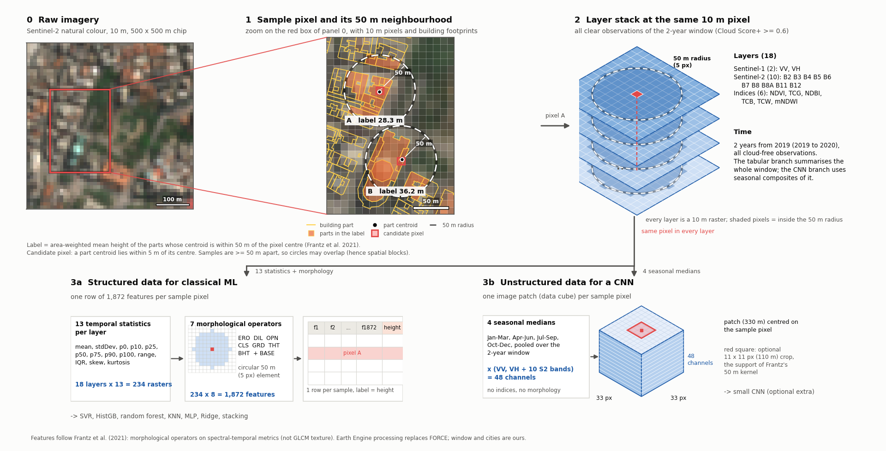

# 10m resolution building height from Sentinel-1/2 in Brazilian cities

Code for the CMP263 (UFRGS) course paper by Guilherme Iablonovski, Thiago Leão and Matheus Pessoa.
The main goal is to predict building heights in a Global South context by feeding Sentinel-1/2 derived features (x) and LiDAR-derived height labels (y) to Machine Learning and Deep Learning models. The feature engineering steps follow the one proposed by Frantz et al. (2021, *Remote Sensing of Environment* 252, 112128) through spectral-temporal metrics and morphological features from Sentinel-1/2. The study areas comprise of eight major Brazilian cities: Porto Alegre, São Paulo, Rio de Janeiro, Belo Horizonte, Salvador, Recife, Curitiba and Niterói.

The pipeline has three steps, run in this order. **Step 0 (feature engineering) cannot be run from this repository alone**, because it needs the municipal building footprints and nDSM (LiDAR) rasters, which are not redistributed. Steps 1 and 2 start from the shipped features table and can be fully rerun.


## Steps

### Step 0. Feature engineering (needs external data)

Builds the sample points and labels from the footprints and nDSMs, extracts the 1,872 Sentinel-1/2 features in Earth Engine,
and merges them into the features table. **It cannot be run without the raw data**: download the footprints and LiDAR from the
city hall portals listed in `data/SOURCES.md` and place them in `data_raw/`. It also needs an Earth Engine account (scripts in `gee/`;).

To skip it, use the features table we ship: 36,217 rows x 1,872 features, published on Zenodo
(together with the CNN patch tensors).

Notebooks: `01_create_sample_points`, `02_merge_gee_exports`, `03_create_cnn_patches` (optional extra).

### Step 1. Spot check

Eight algorithms are tested with default hyper-parameters on the features table, with spatial 5-fold cross-validation.
Notebook: `04_spot_checking`. Runs from the shipped table.

### Step 2. Tuning, training and testing

Nested spatial CV tuning of HistGB and SVR, stacking, final model and natural test evaluation, interpretation, radar importance check and
leave-one-city-out (`05_tuning_and_final_model`), then the full-city maps and building-stock check (`06_full_city_maps`).
Notebook 05 runs from the shipped table; notebook 06 also needs the Earth Engine map exports and the raw data of Step 1.

## Quick start (Steps 1 and 2)

```bash
conda env create -f environment.yml          # Python 3.13, scikit-learn 1.7.2
conda activate sentinel-heights-brazil
python scripts/download_data.py              # features table into data/
jupyter lab                                  # open notebooks/04_spot_checking.ipynb, then 05_...
```

Start Jupyter from the repository root or from `notebooks/`; every notebook finds `notebooks/config.py` either way. All
paths are in that one file and can be moved with environment variables (`FRANTZ_DATA`, `FRANTZ_RAW`, `FRANTZ_GEE`,
`FRANTZ_OUT`), for example to keep the large `outputs/` on an external disk.

To check the algorithm structure in minutes before the long run, set `FAST = True` in the config cell of notebook 04 or 05.

## Notebooks

| Step | # | Notebook | Needs | Runtime (Apple M-series, full run) |
|---|---|---|---|---|
| 0. Feature engineering | 01 | `01_create_sample_points` | raw data (footprints, nDSM) | minutes per city |
| 0. Feature engineering | 02 | `02_merge_gee_exports` | Earth Engine exports | seconds |
| 0. Feature engineering | 03 | `03_create_cnn_patches` (optional extra) | raw data, GEE patches, TensorFlow | minutes per city |
| 1. Spot check | 04 | `04_spot_checking` | features table | hours (SVR about 10 min per fold, random forest about 5 min per fold) |
| 2. Tuning | 05 | `05_tuning_and_final_model` | features table | many hours (one HistGB outer fold took 21 to 86 min) |
| 2. Tuning | 06 | `06_full_city_maps` | notebook 05 models, GEE map exports, raw data | tens of minutes per city |

## Method in brief



* **Label:** area-weighted mean height of the building parts whose centroid lies within 50 m of the pixel.
* **Features:** 18 layers (Sentinel-1 VV, VH; ten Sentinel-2 bands; six indices) x 13 spectral-temporal metrics x 8
  (no operator plus 7 morphological operators within 50 m) = 1,872.
* **Spatial CV:** `StratifiedGroupKFold(5, seed 42)`, groups = city + 2,560 m block, strata = height classes [2, 6, 15, 30] m.
  Scaling, imputation, feature selection and tuning are fitted inside the training folds only. The natural test set is read only for the final evaluation.
* **Tuning:** nested, 3 inner folds; HistGB (25 random-search candidates) and SVR (12), macro RMSE as the criterion;
  ensembles are the plain mean and a non-negative linear stacker fitted on inner out-of-fold predictions.

Deviations from Frantz et al. (not an exact replication):

| Item | Frantz et al. | Here |
|---|---|---|
| Sentinel-2 | FORCE Level-2 (Fmask, BRDF, topographic and adjacency correction), 20 to 10 m data fusion | Sen2Cor L2A (`S2_SR_HARMONIZED`), Cloud Score+ mask (cs_cdf >= 0.6), bilinear 20 to 10 m |
| Sentinel-1 | SNAP, SRTM 3 arc-second | Earth Engine `S1_GRD` (SRTM 30 m, sigma0 in dB, no terrain flattening) |
| Period | S1 2017, S2 2018, one year | two consecutive years from the LiDAR year clamped to 2019..2021 (Recife 2020 to 2021) |
| Building parts | LoD2 CityGML parts | municipal footprint polygons with LiDAR-derived heights |
| Samples per 1 m slice | 1,000 | 200 per city, training set rebalanced towards tall buildings |
| Validation | random 70/30 split | spatial blocks, natural-distribution test set, leave-one-city-out |
| Feature reduction | once, on Berlin | inside every training fold |
| Models | SVR (FORCE) | SVR, KNN, trees, forests, boosting, Ridge, MLP, stacking (scikit-learn) |

## Expected results (from the authors' full runs, to compare with yours)

These come from runs on the authors' machine with the shipped table; a rerun should agree closely but not necessarily to the last digit.

* Nested CV, macro RMSE in m: mean of HistGB and SVR 7.08; stack of all four tuned variants 7.18; HistGB 7.26; SVR 7.27; HistGB weighted 7.44; SVR weighted 7.89.
* Natural test set, final model: RMSE 4.06 m [3.90, 4.25] (95% block-bootstrap CI), macro RMSE 6.72 m [5.57, 7.94], bias +2.05 m.
* Full-city maps, building volume (map minus LiDAR reference, footprints from the reference): total error +45.8% (Porto Alegre), +59.7% (São Paulo), +20.3% (Recife); the errors do not cancel above about 100 m.

## Repository layout

```
notebooks/    config.py and the six notebooks
gee/          Earth Engine Code Editor scripts (JavaScript): features, map features, CNN inputs
scripts/      download_data.py, make_release_table.py, make_gee_point_assets.py
data/         small shipped inputs, README.md, SOURCES.md
data_raw/     NOT in the repo: footprints, nDSMs, boundaries
gee_exports/  NOT in the repo: downloads from Google Drive
outputs/      everything the notebooks write
docs/         format of the CNN patch dataset
tests/        synthetic-data smoke test
```

## Earth Engine scripts

Open them in the Code Editor (`code.earthengine.google.com`) and set `ASSET_ROOT` to your own project. They have **not been
run by the person who prepared this repository** (no Earth Engine access from the development environment); they were run
by the authors, and the shipped features table is their output. `scripts/make_gee_point_assets.py` writes the point files
to upload as table assets.

## What was tested in this repository

Tested on synthetic data only: notebook 04 ran end to end in reduced-size mode (`tests/smoke_test.py`, 47 s); notebook 05's smoke test was **not completed** (it stalled in the sandbox, 2 cores, scikit-learn 1.9, in a joblib worker step; not diagnosed, so run `python tests/smoke_test.py --only 05` and report if it stalls); the self-tests of the sampler (notebook 01) and the merge (notebook 02) pass; the helper scripts
run. **Not run end to end here:** notebooks 01, 03 and 06 (they need the raw data or Earth Engine exports) and the Earth
Engine scripts. Full-size runs of notebooks 04 and 05 are those of the authors.

## Not included

The CNN training code and results are not in this repository yet (only the patch dataset builder, notebook 03).

## Citation and licence

Frantz, D., Schug, F., Okujeni, A., Navacchi, C., Wagner, W., van der Linden, S., & Hostert, P. (2021). National-scale
mapping of building height using Sentinel-1 and Sentinel-2 time series. *Remote Sensing of Environment*, 252, 112128.
https://doi.org/10.1016/j.rse.2020.112128

Code licence: TODO (choose before publishing). Check the licences of the municipal data before publishing any derived labels or points.
