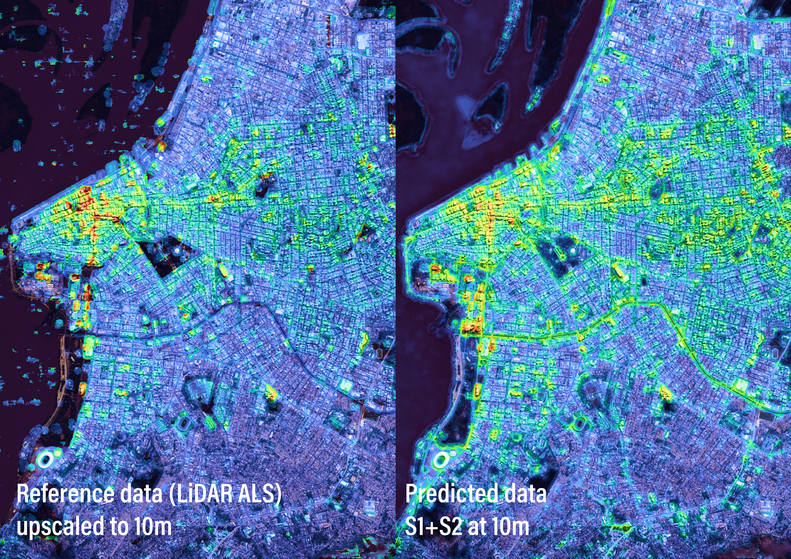

# 10m resolution building height from Sentinel-1/2 in Brazilian cities

Code for the CMP263 (UFRGS) course paper by Guilherme Iablonovski, Thiago Leão and Matheus Pessoa.
The main goal is to predict building heights in a Global South context by feeding Sentinel-1/2 derived features (x) and LiDAR-derived height labels (y) to Machine Learning and Deep Learning models. The feature engineering steps follow the one proposed by Frantz et al. (2021, *Remote Sensing of Environment* 252, 112128) through spectral-temporal metrics and morphological features from Sentinel-1/2. The study areas comprise of eight major Brazilian cities: Porto Alegre, São Paulo, Rio de Janeiro, Belo Horizonte, Salvador, Recife, Curitiba and Niterói.

The pipeline has three steps, run in this order. **Step 0 (feature engineering) cannot be run from this repository alone**, because it needs the municipal building footprints and nDSM (LiDAR) rasters, which are not redistributed. Steps 1 and 2 start from the shipped features table and can be fully rerun.



## Steps

### Step 0. Feature engineering (needs external data)

Builds the sample points and labels from the footprints and nDSMs, extracts the 1,872 Sentinel-1/2 features in Earth Engine,
and merges them into the features table. **It cannot be run without the raw data**: download the footprints and LiDAR from the
city hall portals listed in `data/SOURCES.md` and place them in `data_raw/`. It also needs an Earth Engine account (scripts in `gee/`; set `ASSET_ROOT` to your own project).

To skip it, use the features table we ship: 36,217 rows x 1,872 features, published on Zenodo
(together with the CNN patch tensors).

Notebooks: `00_descriptive_statistics` (descriptive figures and tables of the dataset; section 1 runs from the shipped table), `01_create_sample_points`, `02_merge_gee_exports` and `03_create_cnn_patches` (optional extra).

### Step 1. Spot check

Eight algorithms are tested with default hyper-parameters on the features table, with spatial 5-fold cross-validation.
Notebook: `04_spot_checking`. Runs from the shipped table.

### Step 2. Tuning, training and testing

Nested spatial CV tuning of HistGB and SVR, stacking, final model and natural test evaluation, interpretation, radar importance check and
leave-one-city-out (`05_tuning_and_final_model`), then the full-city maps and building-stock check (`06_full_city_maps`).
Notebook 05 runs from the shipped table; notebook 06 also needs the Earth Engine map exports and the raw data of Step 1.

## Quick start (Steps 1 and 2)

```bash
conda env create -f environment.yml          # Python 3.13, scikit-learn 1.7.2
conda activate sentinel-heights-brazil
jupyter lab                                  # open notebooks/04_spot_checking.ipynb, then 05_...
```

Start Jupyter from the repository root or from `notebooks/`; every notebook finds `notebooks/config.py` either way. All
paths are in that one file and can be moved with environment variables (`FRANTZ_DATA`, `FRANTZ_RAW`, `FRANTZ_GEE`,
`FRANTZ_OUT`), for example to keep the large `outputs/` on an external disk.

To check the algorithm structure in minutes before the long run, set `FAST = True` in the config cell of notebook 04 or 05.

## Notebooks

| Step | # | Notebook | Needs | Runtime (full run) |
|---|---|---|---|---|
| 0. Feature engineering | 00 | `00_descriptive_statistics` | features table (section 1); Earth Engine and footprints (sections 2 and 3, optional) | minutes |
| 0. Feature engineering | 01 | `01_create_sample_points` | raw data (footprints, nDSM) | minutes per city |
| 0. Feature engineering | 02 | `02_merge_gee_exports` | Earth Engine exports | seconds |
| 0. Feature engineering | 03 | `03_create_cnn_patches` | raw data, GEE patches, TensorFlow | minutes per city |
| 1. Spot check | 04 | `04_spot_checking` | features table | hours (SVR about 10 min per fold, random forest about 5 min per fold) |
| 2. Tuning | 05 | `05_tuning_and_final_model` | features table | many hours (one HistGB outer fold took 21 to 86 min) |
| 2. Tuning | 06 | `06_full_city_maps` | notebook 05 models, GEE map exports, raw data | tens of minutes per city |

## Method in brief


* **Label:** area-weighted mean height of the building parts whose centroid lies within 50 m of the pixel.
* **Features:** 18 layers (Sentinel-1 VV, VH; ten Sentinel-2 bands; six indices) x 13 spectral-temporal metrics x 8 morphological operators within 50 m = 1,872.
* **Spatial CV:** `StratifiedGroupKFold(5)`, groups = city + 2,560 m block, strata = height classes [2, 6, 15, 30] m.
  Scaling, imputation, feature selection and tuning are fitted inside the training folds only. The natural test set is read only for the final evaluation.
* **Tuning:** nested, 3 inner folds; HistGB (25 random-search candidates) and SVR (12), macro RMSE as the criterion;
  ensembles are the plain mean and a non-negative linear stacker fitted on inner out-of-fold predictions.

## Expected results

* Nested CV, macro RMSE in m: mean of HistGB and SVR 7.08; stack of all four tuned variants 7.18; HistGB 7.26; SVR 7.27; HistGB weighted 7.44; SVR weighted 7.89.
* Natural test set, final model: RMSE 4.06 m, macro RMSE 6.72 m, bias +2.05 m.
* Full-city maps, building volume (map minus LiDAR reference, footprints from the reference): total error +45.8% (Porto Alegre), +59.7% (São Paulo), +20.3% (Recife).

## Repository layout

```
notebooks/    config.py and the seven notebooks
gee/          Earth Engine Code Editor scripts (JavaScript): features, map features, CNN inputs
data/         small shipped inputs, README.md, SOURCES.md
data_raw/     NOT in the repo: footprints, nDSMs, boundaries
gee_exports/  NOT in the repo: downloads from Google Drive
outputs/      everything the notebooks write
```

## Citation and licence

Frantz, D., Schug, F., Okujeni, A., Navacchi, C., Wagner, W., van der Linden, S., & Hostert, P. (2021). National-scale
mapping of building height using Sentinel-1 and Sentinel-2 time series. *Remote Sensing of Environment*, 252, 112128.
https://doi.org/10.1016/j.rse.2020.112128
